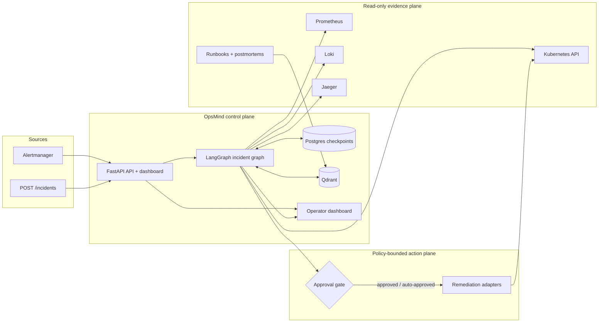
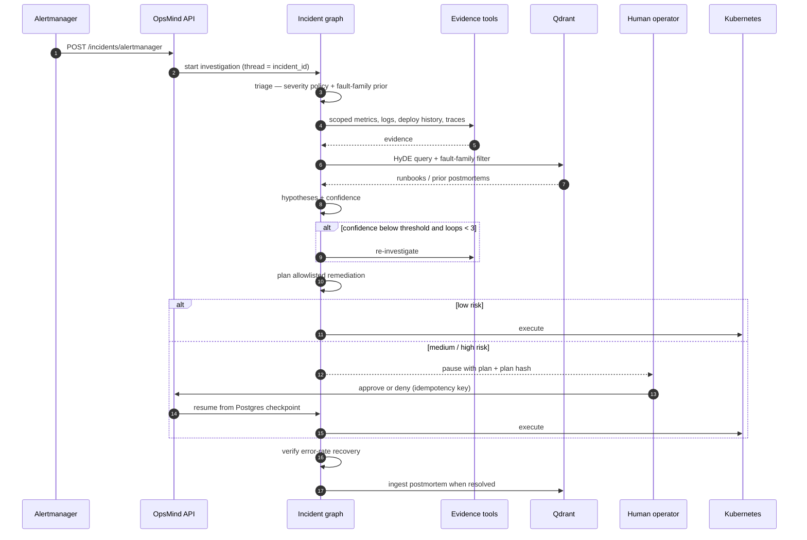
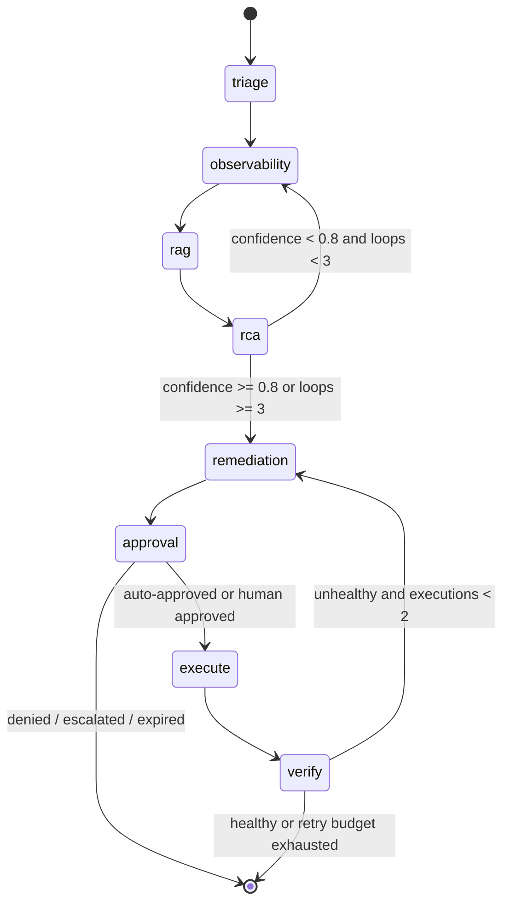
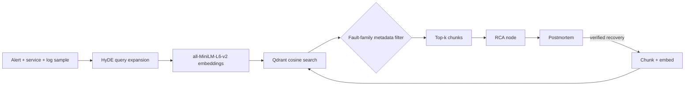
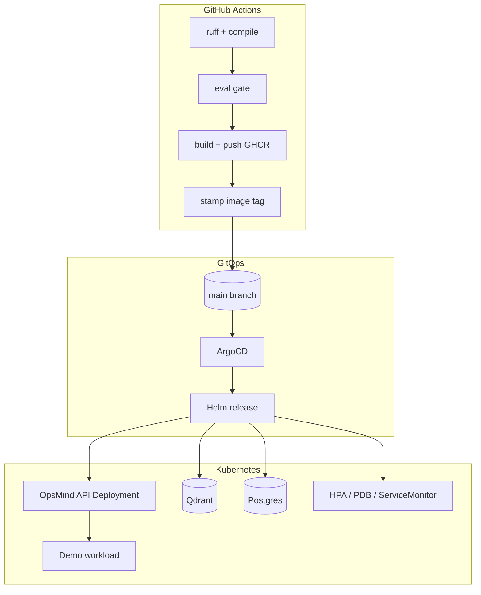

# OpsMind

**An autonomous incident-response agent for Kubernetes — evidence-driven, policy-bounded, and human-gated.**

[](https://github.com/MdSaifAliMolla/OpsMind/actions/workflows/ci-cd.yml)

OpsMind receives alerts from Alertmanager, investigates the affected service across
Prometheus, Loki, Jaeger, and the Kubernetes API, retrieves relevant runbooks and
prior postmortems, and produces a ranked root-cause analysis with a concrete
remediation plan. Low-risk actions can run automatically; medium- and high-risk
actions pause the incident graph until a human approves the exact plan that was
proposed. Resolved incidents generate postmortems that are fed back into the
retrieval corpus.

The system is built as a production-shaped reference implementation: checkpointed
workflows, explicit trust boundaries, an evaluation harness, infrastructure as
code, and a GitOps delivery path.

> **Status:** active engineering prototype. The agent is evaluated on a generated
> incident corpus and on recorded chaos bundles, not on production traffic. See
> [Evaluation](#evaluation) and [Limitations](#limitations).

---

## Contents

- [Capabilities](#capabilities)
- [Architecture](#architecture)
- [Incident lifecycle](#incident-lifecycle)
- [Agent graph](#agent-graph)
- [Retrieval pipeline](#retrieval-pipeline)
- [Safety model](#safety-model)
- [Evaluation](#evaluation)
- [Deployment](#deployment)
- [Quick start](#quick-start)
- [API](#api)
- [Configuration](#configuration)
- [Observability](#observability)
- [Repository layout](#repository-layout)
- [Design decisions](#design-decisions)
- [Limitations](#limitations)
- [Roadmap](#roadmap)

---

## Capabilities

| Area | What OpsMind does |
|---|---|
| **Ingestion** | Alertmanager webhook and a typed REST endpoint; alert windows are preserved for time-bounded log/trace queries. |
| **Triage** | Severity from Alertmanager labels when present, otherwise documented burn-rate and health thresholds. A fault-family classifier supplies an advisory prior. |
| **Investigation** | Read-only, per-incident tool calls against Prometheus, Loki, Jaeger, and Kubernetes, plus runbook retrieval. Tool scope is bound to the incident service. |
| **Diagnosis** | 2–3 competing hypotheses with supporting/contradicting evidence and a confidence score. Low confidence loops back for another investigation pass (max 3). |
| **Remediation** | A closed allowlist of actions with risk tiers. Plans carry a deterministic hash used to bind approvals to the reviewed plan. |
| **Human control** | Approval TTL, approver identity option, idempotency keys, deny path, and an append-only audit trail. |
| **Verification** | Post-action error-rate comparison and rollout health check. Failed recovery can re-plan once. |
| **Learning** | Successful postmortems are chunked, embedded, and upserted into Qdrant so future investigations retrieve them. |
| **Operations** | Prometheus metrics, Grafana dashboards, SLO burn-rate rules, Alertmanager routing, OpenTelemetry traces, Langfuse LLM traces, Slack-compatible notifications. |
| **Delivery** | Docker Compose, raw Kubernetes manifests, Helm chart, ArgoCD application, kind cluster profiles, GitHub Actions with lint, eval gate, image build, and GitOps tag stamping. |

## Architecture



**Components**

| Component | Responsibility |
|---|---|
| `app/api` | Webhook ingestion, REST API, approval/deny endpoints, rate limiting, audit persistence, static dashboard. |
| `app/agents` | LangGraph nodes: triage, observability, RAG, RCA, remediation, approval, execute, verify, postmortem. |
| `app/tools` | Typed adapters for Prometheus, Loki, Jaeger, and Kubernetes. All evidence collection is read-only and service-scoped. |
| `app/security` | Untrusted-content wrapping, prompt-injection heuristics, sanitization, plan validation. |
| `app/policy` | Severity thresholds, fault catalog, risk table, allowlisted actions. |
| `app/rag` | Ingestion, embeddings, HyDE retrieval, metadata filtering, postmortem feedback. |
| `app/ml` | Fault-family prior (XGBoost when available, random forest fallback) and feature extraction. |
| `app/evaluation` | Offline harness, recorded-run bundles, RAGAS-style scoring, calibration, cost and safety analysis. |
| `app/observability` | Prometheus exposition, OpenTelemetry tracing, Langfuse integration, notifier. |
| `public` | Operator dashboard: incident list, evidence trace, hypotheses, approval controls, live metrics. |

## Incident lifecycle



## Agent graph



| Node | Input | Output |
|---|---|---|
| `triage` | Alert labels and metrics | Severity, severity source, fault-family prior |
| `observability` | Scoped incident | Evidence from metrics, logs, Kubernetes, traces |
| `rag` | Alert context | Runbook and postmortem excerpts with scores |
| `rca` | Wrapped evidence | Ranked hypotheses, confidence, root cause |
| `remediation` | Root cause and metrics | Allowlisted action, parameters, risk level |
| `approval` | Plan | Auto-approve, pause, reject, or escalate |
| `execute` | Approved plan | Adapter result and pre-action error rate |
| `verify` | Execution result | Before/after error rate and rollout health |
| `postmortem` | Resolved incident | Markdown postmortem returned to the API |

Graph state is checkpointed in Postgres with `thread_id = incident_id`. A paused
approval survives API restarts and can be resumed after a restart. Approval
metadata itself is process-local, so multi-replica deployments must route
approval requests to the originating process or add a shared store (see
[Limitations](#limitations)).

## Retrieval pipeline



- Runbooks are split on Markdown headings, then by size, embedded, and stored with
  source and fault-family metadata in the `runbooks` collection.
- Retrieval uses cosine similarity over a fault-family-filtered candidate set.
  Resolved postmortems receive a modest relevance boost over static runbooks.
- HyDE generates a hypothetical postmortem from the alert before retrieval. It is
  a required step: retrieval fails closed when the LLM is unavailable.
- Successful postmortems are written back to the corpus, closing the loop between
  incident response and organizational memory.

## Safety model

OpsMind is designed around **bounded autonomy**, not unrestricted agency.

| Control | Implementation |
|---|---|
| Closed action set | `restart pods`, `scale replicas`, `restart redis`, `rollback deployment`, `escalate`. Anything else is rejected. |
| Risk tiers | Low-risk actions may auto-execute; medium/high-risk actions require human approval; forbidden actions are rejected. |
| Plan binding | Approval is tied to a SHA-256 hash of the exact remediation plan. A changed plan cannot reuse an old approval. |
| Approval expiry | Configurable TTL (`OPSMIND_APPROVAL_TTL_MIN`); expired approvals are swept and marked in the audit trail. |
| Idempotency | Approve/deny calls accept an idempotency key; replays return the original result. |
| Execution guard | Kubernetes mutations require `OPSMIND_EXECUTE=true`; compose and kind default to `false`. |
| Read-only investigation | Evidence tools are query-only; action adapters are separate and only reachable after the approval node. |
| Service scoping | Tool calls validate DNS-safe service names and limit queries to the incident service/namespace. |
| Untrusted content | Logs, descriptions, and tool output are wrapped in `<untrusted>` tags, control characters are stripped, and a prompt-injection heuristic forces human review. |
| Input limits | Pydantic bounds on payloads, capped evidence items, capped tool-call counts, and per-IP POST rate limiting. |
| Audit trail | Incidents, approvals, denials, and execution results are persisted in Postgres; the clear endpoint is disabled in strict mode. |

Prompt-injection detection is intentionally conservative: a positive match does not
block the investigation, it removes the ability to auto-execute and routes the
decision to a human.

## Evaluation

The evaluation harness measures the agent end to end on generated incidents and
the RCA/remediation path on recorded chaos bundles.

**Offline benchmark — 131 incidents, 20 unseen fault types**

| Metric | Overall (n=131) | Known faults (n=111) | Unseen faults (n=20) |
|---|---:|---:|---:|
| Severity accuracy | **98.5%** | 98.2% | 100% |
| Root-cause accuracy | **68.7%** | 66.7% | 80.0% |
| Runbook hit@3 | **77.9%** | — | — |
| Median end-to-end latency | **16.3 s** | — | — |
| Mean cost per incident | **$0.00032** | — | — |
| Forbidden actions proposed | **0** | 0 | 0 |

The corpus mixes known and unseen fault families so the harness reports
generalization separately from memorization. RCA matches use lexical containment
plus embedding similarity against ground truth. The report also emits confidence
calibration, a failure taxonomy, retrieval hit@3, remediation safety, and cost
statistics. The latest generated report is checked in at
[`docs/eval/REPORT.md`](docs/eval/REPORT.md).

Reproduce:

```bash
python data/generate_incidents.py --n 160
python -m app.ml.family
python -m app.rag.ingest
python -m app.evaluation.run
python -m app.evaluation.report --results app/evaluation/results.json --out docs/eval/REPORT.md
```

Recorded-run evaluation (no cluster required for scoring):

```bash
python -m app.evaluation.run_offline --dir data/bundles
```

**What the numbers mean.** Severity is largely policy-driven and is expected to be
high. RCA is the harder task: 68.7% overall, with stronger accuracy on the unseen
slice. The benchmark is generated, so these numbers should be read as a regression
gate and a measure of pipeline quality, not as a claim about production incident
accuracy.

## Deployment

### Local full stack

`docker compose` starts Postgres, Qdrant, MLflow, Prometheus, Alertmanager, Loki,
Promtail, Jaeger, the OpenTelemetry Collector, Grafana, the demo checkout service,
and the OpsMind API.

| Service | URL |
|---|---|
| OpsMind dashboard | http://localhost:4000 |
| Grafana | http://localhost:3001 (admin/admin) |
| Prometheus | http://localhost:9090 |
| Alertmanager | http://localhost:9093 |
| Jaeger | http://localhost:16686 |
| MLflow | http://localhost:5000 |
| Demo checkout | http://localhost:8002 |

The demo service exposes chaos switches (`/chaos/errors`, `/chaos/slow`) so the
full alert-to-remediation path can be exercised without a real outage.

### Kubernetes and GitOps



- `helm/opsmind` packages the API, Postgres, Qdrant, HPA, ingress, service account,
  and ServiceMonitor.
- `argocd/app.yaml` defines the GitOps application with automated sync and self-heal.
- `kind/` contains cluster and workload profiles for local multi-node testing. The
  kind profile also ships Prometheus recording rules that map cluster-native signals
  (replica availability, cAdvisor CPU/memory, probe latency, network rate) onto the
  metric names the agent queries.
- `chaos/oom-stress.yaml` provides a repeatable memory-pressure fault.
- `.github/workflows/ci-cd.yml` runs lint, model training, RAG ingestion, gated
  evaluation, image build/push, Helm lint, kubeconform validation, and image-tag
  stamping back to `main`.

If the GHCR package is private, either make it public or create a pull secret and
pass it with `--set imagePullSecrets[0].name=<secret>`.

## Quick start

**Requirements:** Python 3.11+, Docker, a Google API key for the LLM, and a
Postgres instance (required — the graph has no in-memory checkpointer fallback).

```bash
python -m venv .venv
source .venv/bin/activate
pip install -r requirements.txt

cp .env.example .env
# Set GOOGLE_API_KEY and DATABASE_URL in .env

docker compose up -d postgres qdrant

python data/generate_incidents.py --n 160
python -m app.ml.family
python -m app.rag.ingest

uvicorn app.api.server:app --host 0.0.0.0 --port 4000
```

The API and dashboard are available at `http://localhost:4000`. To exercise the
investigation tools, start the observability services as well:

```bash
docker compose up -d prometheus alertmanager loki promtail jaeger otel-collector
```

On Windows, activate the environment with `.venv\Scripts\activate` and substitute
`py` for `python` if preferred.

### Tests

```bash
pip install -r requirements-dev.txt
python -m pytest -q
```

The suite covers policy thresholds, plan validation, approval routing, prompt
injection handling, rate limiting, and evaluation statistics. It runs without a
database, cluster, or API key.

### End-to-end demo

```bash
# Break the demo checkout service
curl -X POST http://localhost:8002/chaos/errors

# Prometheus fires DemoFastBurn; Alertmanager forwards to OpsMind
# Watch the investigation at http://localhost:4000

# Approve the proposed remediation
curl -X POST http://localhost:4000/incidents/<INCIDENT_ID>/approve \
  -H "Content-Type: application/json" \
  -d '{"approved_by":"operator"}'
```

Triggering the same fault again should retrieve the newly ingested postmortem and
converge faster.

## API

Base URL: `http://localhost:4000`. When `OPSMIND_API_KEY` is set, clients must
send `X-API-Key`; the Alertmanager webhook uses `OPSMIND_ALERTMANAGER_KEY`.

| Method | Path | Purpose |
|---|---|---|
| `GET` | `/health` | Liveness and pending-thread count |
| `GET` | `/metrics` | Prometheus metrics for the agent itself |
| `GET` | `/incidents` | List persisted investigations |
| `GET` | `/incidents/{id}` | Current graph state for an incident |
| `POST` | `/incidents` | Submit an incident manually |
| `POST` | `/incidents/alertmanager` | Alertmanager webhook receiver |
| `POST` | `/incidents/{id}/approve` | Approve a paused plan |
| `POST` | `/incidents/{id}/deny` | Reject a paused plan |
| `DELETE` | `/incidents` | Disabled; audit records are append-only |
| `GET` | `/demo/{id}.json` | Read-only sample incident for the dashboard |

Approval and denial accept an optional `Idempotency-Key` header. Messages are
validated with Pydantic and size-bounded.

## Configuration

| Variable | Default | Purpose |
|---|---|---|
| `GOOGLE_API_KEY` | required | Gemini access for reasoning and HyDE |
| `GEMINI_MODEL` | `gemini-3.5-flash-lite` | Model identifier |
| `DATABASE_URL` | required | Incident store and LangGraph checkpoints |
| `QDRANT_URL` | required | Vector store |
| `PROMETHEUS_URL` | required | Metrics evidence |
| `LOKI_URL` | required | Log evidence |
| `JAEGER_URL` | required | Trace evidence |
| `OPSMIND_NAMESPACE` | required | Kubernetes namespace for remediation |
| `OPSMIND_EXECUTE` | `false` | Enables Kubernetes mutations |
| `OPSMIND_APPROVAL_TTL_MIN` | `60` | Approval validity window; `0` disables expiry |
| `OPSMIND_REQUIRE_APPROVER` | `false` | Requires an approver identity |
| `OPSMIND_API_KEY` | unset | Shared-secret API auth |
| `OPSMIND_ALERTMANAGER_KEY` | falls back to API key | Webhook auth |
| `OPSMIND_RATE_LIMIT_PER_MIN` | `0` | Per-IP POST limit; `0` disables |
| `SLACK_WEBHOOK_URL` | unset | Incident notifications |
| `LANGFUSE_*` | unset | LLM tracing |
| `OTEL_EXPORTER_OTLP_ENDPOINT` | unset | OTLP trace export |
| `HF_HUB_OFFLINE` | `0` | Use the baked-in embedding model cache |

## Observability

**Agent metrics** (`/metrics`): incident counts by status and severity, remediation
counts by risk, RCA confidence, latency, tool calls, RAG queries, LLM calls,
tokens, cost, errors, success rate, and the last gated evaluation scores.

**Platform telemetry:**

- Prometheus scrapes the API and the demo workload and evaluates SLO burn-rate rules.
- Alertmanager routes firing alerts to `/incidents/alertmanager`.
- Promtail ships structured JSON logs to Loki with an `app` label.
- The OpenTelemetry Collector forwards spans to Jaeger; the API also exports spans
  for each graph node and LLM call.
- Grafana ships dashboards for agent health, LLM cost/latency, and incident flow.
- Langfuse records prompts, completions, token usage, and per-node latency when keys
  are configured.

## Repository layout

```text
app/
  agents/         LangGraph nodes, state, LLM provider, postmortem writer
  api/            FastAPI app, approvals, persistence, rate limiting
  demo/           Chaos-enabled checkout service used by the local stack
  evaluation/     Harness, bundles, calibration, RAGAS-style scoring, reports
  ml/             Fault-family classifier and feature extraction
  observability/  Metrics, tracing, Langfuse, notifier
  policy/         Severity rules, fault catalog, risk table
  rag/            Ingestion, embeddings, retrieval, feedback
  security/       Untrusted-content handling and injection detection
  tools/          Prometheus, Loki, Jaeger, Kubernetes adapters
  mcp_server.py   MCP server exposing the read-only investigation tools
public/           Operator dashboard (vanilla JS/CSS)
data/
  generate_incidents.py  Synthetic incident generator
  runbooks/              Operational runbooks used by retrieval
  bundles/               Recorded chaos-run bundles for offline evaluation
docker/           Compose service configuration and Grafana provisioning
helm/             Helm chart for the API, Postgres, and Qdrant
k8s/              Raw Kubernetes manifests
argocd/           GitOps application definition
kind/             Local cluster and workload profiles
chaos/            Chaos experiments
rollouts/         Canary rollout definition
scripts/          Cluster bootstrap and run-recording helpers
```

## Design decisions

**Policy beats a model for severity.** Alertmanager already encodes the burn-rate
policy. Re-learning it with a classifier would add opacity without adding signal.
The classifier is reserved for fault family, where labels actually exist.

**The prior is advisory, not an oracle.** A wrong fault family would scope evidence
collection incorrectly, so unknown families are dropped instead of forced. The RCA
node can overrule the prior when the evidence disagrees.

**The agent proposes; policy and humans dispose.** The action set is closed, risk
tiers are explicit, and the execution adapter is unreachable until the approval
node completes. Execution is disabled by default.

**Approvals bind to content.** A hash of the exact plan prevents a stale approval
from authorizing a different action after re-planning.

**Evidence is untrusted by construction.** Logs and tool output are data, not
instructions. Wrapping, sanitization, and injection heuristics make that boundary
explicit and testable.

**Fail closed on infrastructure.** Missing Postgres, Qdrant, Prometheus, Loki, or
Jaeger configurations raise rather than silently degrading to guesses. An empty
log or trace result is still a valid observation.

**Cheap by design.** The median investigation costs a fraction of a cent, which
makes broad offline evaluation and continuous regression testing practical.

## Limitations

- **Generated benchmark.** The 131-incident corpus is synthetic. The next step is a
  larger corpus of recorded chaos runs and real postmortems, grouped by run to avoid
  leakage.
- **RCA accuracy.** 68.7% overall is useful but not sufficient for unattended
  diagnosis. Human review remains mandatory for medium/high-risk actions.
- **Confidence calibration.** The current run has ECE 0.22 and high-confidence
  accuracy below the 0.8 re-investigation threshold, so the threshold should be
  re-tuned against a larger corpus before it is treated as a safety property.
- **Single-process approval metadata.** Approval TTL and idempotency state live in
  process memory. The graph checkpoint is durable in Postgres, but multi-replica
  deployments need a shared approval store or sticky routing. The Helm chart's
  default replica count should be raised only after that change.
- **Execution adapters are cluster-specific.** The Kubernetes adapter requires RBAC
  and a reachable cluster; `OPSMIND_EXECUTE=false` is the safe default.
- **Auth is a shared secret.** There is no per-user identity, RBAC, or OIDC
  integration yet. Deploy behind an authenticated ingress for shared environments.
- **No multi-cluster routing.** The agent targets one namespace in one cluster per
  deployment.

## Roadmap

- Shared approval/idempotency store for horizontally scaled deployments.
- Recorded-chaos corpus with grouped train/eval splits and per-family error bars.
- OIDC-backed approver identity and signed audit export.
- Cost-aware model routing and prompt caching.
- Multi-cluster and multi-tenant incident routing.
- Canary analysis as a first-class verification signal.

---

Built with Python, FastAPI, LangGraph, Gemini, Qdrant, Postgres, XGBoost,
Prometheus, Loki, Jaeger, OpenTelemetry, Grafana, Docker, Kubernetes, Helm, ArgoCD,
and GitHub Actions.
